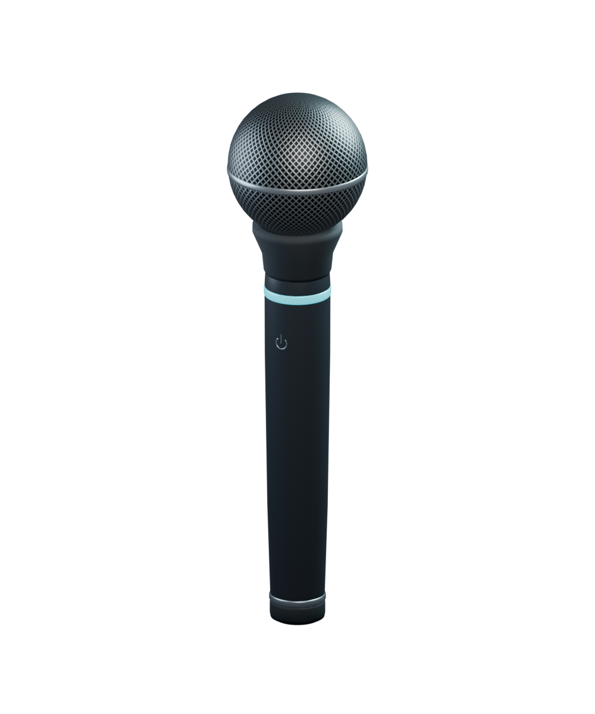

# Handheld microphone

Original microphone created in Blender through MCP for the fist-to-mouth voice interaction.
Graphite body, silver woven grille, and an independently controllable cyan listening ring.
Geometry and textures are procedural originals; no third-party models or textures are included.



## Files

- [`microphone.glb`](microphone.glb): self-contained glTF 2.0 runtime asset, **239,788 bytes** (234 KiB).
- [`microphone.blend`](microphone.blend): editable model, packed textures, preview camera and lighting.
- [`previews/microphone-idle.png`](previews/microphone-idle.png) and
  [`previews/microphone-listening.png`](previews/microphone-listening.png): state previews.
- [`previews/microphone-roundtrip.png`](previews/microphone-roundtrip.png): render of the actual re-imported GLB.
- [`asset-info.json`](asset-info.json) and [`validation.json`](validation.json): dimensions, budget and verification.

## Asset contract

| Property | Value |
|---|---|
| Dimensions | 22.2 cm tall, 5.65 cm maximum diameter |
| Geometry | 4,988 triangles; 5 meshes / material primitives |
| Materials | 5 opaque PBR materials; backface culling enabled |
| Textures | Two embedded 1024 × 512 PNGs: grille base color and tangent normal |
| Coordinate system | GLB is meters, Y-up; Blender source is Z-up |
| Grip origin | `MIC_Grip`, `(0, 0, 0)`; parent the complete hierarchy here |
| Orientation | Local `+Y` points toward grille; `+Z` faces the power mark |
| Grille tip | `MIC_MouthAnchor`, local GLB `(0, 0.144, 0)` meters |
| Feedback mesh / material | `MIC_Indicator` / `MIC_ListeningIndicator` |
| Animation | None; app controls visibility, pose and indicator |
| Dependencies | No external files, skins, lights, cameras, or glTF extensions |

The root sits inside the handle where the fist grips it. The handle extends 7.8 cm below this
origin and the grille tip extends 14.4 cm above it. Load at scale `1.0`; the asset is already
real-world size. Keep the hand attachment transform separate from a presentation scale animation.
No collision or interaction geometry is included; use the tracked hand for proximity checks.

## Attachment and listening feedback

Bundle the GLB with the Quest app's model assets. Parent `MIC_Grip` to a **calibrated palm/grip
pose**, aligning its axis with the thumb/index opening of a relaxed fist. A controller or hand
aim pose is not automatically a grip pose: check the offset and orientation on the headset.
Use the same asset for either hand; change the attachment rotation, avoiding negative scale.

Show it as the voice hand approaches the mouth with a closed fist. A brief 100–150 ms reveal
can soften its appearance. Let the real tracked hand remain in control of the pose. Test
`MIC_MouthAnchor` against the estimated mouth to keep the grille outside the face and headset
near plane; tune the grip offset or overall size if it intersects.

Clone the indicator material for each instance, then drive its standard glTF PBR values:

| State | `baseColorFactor` (linear RGBA) | `emissiveFactor` (linear RGB) |
|---|---|---|
| Idle / approaching | `[0.018, 0.16, 0.19, 1]` | `[0, 0, 0]` |
| Audio capture running | `[0.01, 0.65, 0.75, 1]` | `[0, 0.8, 1]` |

The exported file starts idle. Light the ring only after capture actually starts; permission or
connection failures should leave it idle and show the existing voice notice. Bloom is optional.

## Fist-to-mouth trigger contract

This package supplies the asset. The app loads it and holds `MIC_Grip` at the fist's grip pose
(`app/src/main/kotlin/dev/improve/vrcode/hands/FistGrip.kt`): the hollow inside the curled
fingers, `+Y` out of the thumb-and-index side, rebuilt each frame from the OpenXR hand joints so
it turns with the wrist. Mouth gating still needs runtime wiring. The following are **starting values for headset tuning**, not measured thresholds:

1. Use the configured voice hand (currently left). Retain the app's fist debounce. Require valid
   hand and head poses, an actual tracked hand, and no active OS system gesture.
2. Estimate a mouth point from the head pose. Start about **10 cm below the eye center** in head
   space; tune the forward offset and offer calibration. This does not require face tracking.
3. Enter when the fist's calibrated grip center stays within **18 cm** of the mouth for **150 ms**.
   Require it to be in front of the head. Test grip distance, not the much farther wrist position.
4. Start capture once on that transition. Keep following the hand while listening. Opening the
   hand, lowering it beyond **26 cm** for **250 ms**, or losing tracking ends capture. The larger
   exit radius prevents boundary flicker. Tracking loss should not leave recording latched on.
5. On exit, finalize into the existing staged transcript. Inserting/sending remains an explicit
   action; moving the fist never sends text. Retain a panel button as the gesture fallback.

Consume competing thumb microgestures while this near-mouth interaction is active. Re-arm after
the hand opens or leaves the exit radius; avoid an immediate restart after a capture error.
Validate false starts from resting the chin on a fist, occlusion near the headset, left/right
hand roles, and tracking loss before treating these values as defaults.

The existing `HandInput.leftFist` signal detects a fist regardless of its position. Place the
proximity state between that signal and `VoiceController.startListening()` / `stopListening()`;
drive the ring from the controller's actual `Listening` phase.

## Editing and verification

Open `microphone.blend` to edit the asset. The preview studio is separate from `MIC_Asset` and
is excluded from the GLB. Export only the asset hierarchy, with Y-up, normals, UVs and tangents.

The editable `.blend` file is the source of truth. Make geometry/material edits and export the
asset hierarchy through Blender's glTF export UI. Repository tooling uses Bun exclusively.

Validate the delivered GLBs and render a preview of the saved source project with:

```sh
bun run assets:validate
bun run assets:preview --asset microphone
```

The validator reads the GLB directly and checks its catalog contract, including dimensions from
actual transformed vertices. Previews go to `artifacts/asset-previews/` by default. Rendering uses
Blender's standard background CLI with script auto-execution disabled and preserves the live project.
These commands do not reconstruct the model, export a GLB, or rerun Blender re-import/mesh-health
checks. The earlier `validation.json` and roundtrip previews remain historical verification evidence.

Verified in Blender 5.2.3 LTS: GLB structure, embedded textures, triangle budget, axes, dimensions,
UVs/tangents, closed outward mesh surfaces after welding export seams, and a fresh-process GLB
re-import/render. Quest runtime loading, hand fit and gesture thresholds have not been tested.
