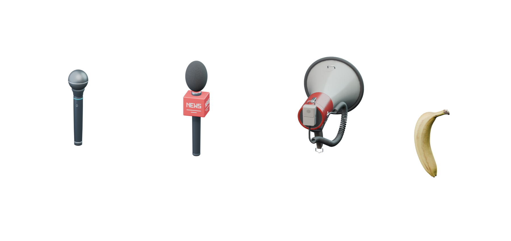

# Voice props

Voice input can wear a different prop while keeping the same fist-to-mouth interaction.
This starter set contains four looks, including two original microphones and two Poly Haven models.



| Look | Model | Triangles | Materials | GLB size |
|---|---|---:|---:|---:|
| The Classic | [Microphone](../microphone/microphone.glb) | 4,988 | 5 | 234 KiB |
| News microphone | [News microphone](news-microphone.glb) | 6,800 | 5 | 313 KiB |
| The Announcer | [Megaphone](megaphone.glb) | 15,814 | 1 | 4.09 MiB |
| Banana Phone | [Banana](banana.glb) | 5,016 | 1 | 4.04 MiB |

The news microphone is an original 28 cm reporter microphone with a textured black foam
windscreen, graphite handle, metal collars, and a red beveled mic flag with raised white
NEWS lettering on all four sides. It replaces the boombox and appears second in the picker;
saved boombox preferences migrate to it.

The imported props use 1k textures, embedded in each GLB. Grip offsets and speech-reference
anchors are prepared as starting points. The Quest app bundles all four models and exposes
them under **Settings → Customization → Voice prop**. Selection saves immediately and switches
the model shown during dictation. Quest hand fit, mouth clearance and frame time still need
wearer/device verification.

Open [voice-props.blend](voice-props.blend) to inspect all four. The display scene spaces them
apart; each standalone GLB has its grip root at the origin and unit scale. Individual source
renders and re-import renders are in [previews](previews).

## Shared interaction

[catalog.json](catalog.json) records the model URI, grip node, speech anchor, dimensions,
triangle/material counts, source and license per look. Positions use meters and glTF Y-up.
Each model can attach through the same hand-attachment system using its descriptor's node
names. Calibrate the hand-to-grip transform on the headset; a hand aim transform may differ.

Keep gesture recognition and audio capture independent of the model. The speech anchor helps
check visual clearance; switching to a banana should not change the gesture's trigger distance
or transcript behavior. See the [fist-to-mouth contract](../microphone/README.md).

The Classic includes a controllable emissive ring. Imported props currently use their original
materials and have no recording animation. Provide a shared listening badge, transcript state
and optional haptic/audio cue for every skin; drive that feedback from actual capture state.
All four props use opaque materials.

For customization, start with model choice, handedness, a bounded size control and saved grip
adjustments. The imported textures contain baked colors: tinting a material affects all of its
painted regions. Independent shell/grille colors need material splits or masks. Keep one prop
loaded at a time, and prepare GPU-compressed textures/LODs after measuring on the Quest.

## Blender asset libraries

**Poly Haven** supplied the imported models. Sketchfab and Poly Pizza require API keys.
Configure optional libraries manually in Blender Preferences → Add-ons → MCP for Blender.
Repository tooling does not install or execute Blender startup scripts.

Poly Haven's models/textures are [CC0](https://polyhaven.com/license), including commercial use
and redistribution. Retain per-asset license metadata when expanding into other catalogs;
Sketchfab and Poly Pizza assets can have different licenses. [CREDITS.md](CREDITS.md) records
the imported models' artists and source pages.

## Rebuild and verification

The editable [voice-props.blend](voice-props.blend) is the source of truth for the prepared models.
Make edits and export each asset hierarchy through Blender's glTF export UI. Keep grip roots at
the origin with unit scale, normalize dimensions, triangulate meshes, and export normals, UVs,
tangents and embedded textures. Update [catalog.json](catalog.json) when the asset contract changes.

Repository scripts run exclusively with Bun:

```sh
bun run assets:validate
bun run assets:preview --asset voice-props
```

The Bun validator reads actual GLB vertices to verify dimensions, anchors, triangle/material
counts, embedded textures, vertex attributes and alpha modes. The preview command renders the
saved review scene through Blender's background CLI with script auto-execution disabled; output
goes to `artifacts/asset-previews/`. It does not rebuild/export models or perform GLB re-imports.
[validation.json](validation.json) records the current Bun validation report. The lineup and
news microphone preview were rendered from the updated Blender source. The existing
`*-roundtrip.png` files record earlier re-import checks for the other three props.

More directions to explore: a walkie-talkie, telephone receiver, seashell, toy ray gun, ice cream
cone, rubber duck or tiny gramophone. Source each model, verify its license, then add the same
grip/anchor metadata. No extra model is downloaded by the app from these libraries automatically.
