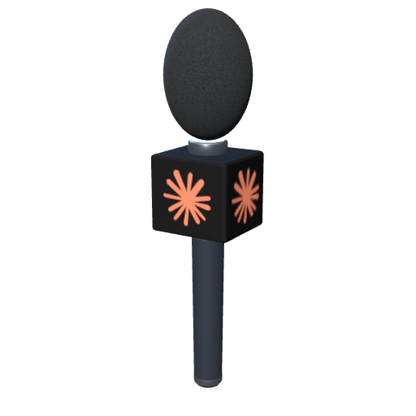
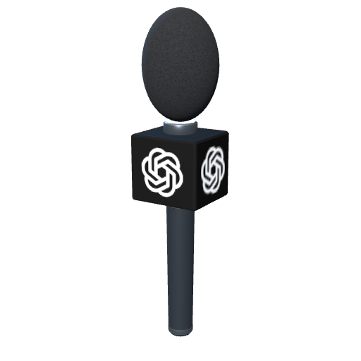
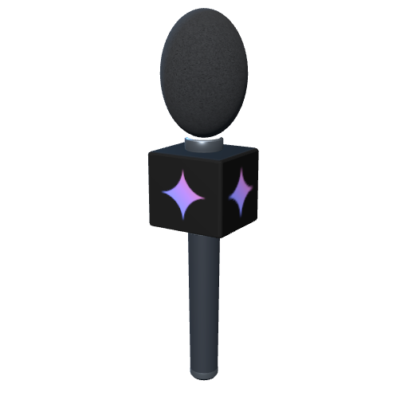

# Voice props

Voice input can wear a different prop while keeping the same fist-to-mouth interaction.
This starter set contains four looks, including two original microphones and two Poly Haven models.

| Claude | ChatGPT | Gemini |
|:---:|:---:|:---:|
|  |  |  |

| Look | Model | Triangles | Materials | GLB size |
|---|---|---:|---:|---:|
| The Classic | [Microphone](../microphone/microphone.glb) | 4,988 | 5 | 234 KiB |
| News microphone | [Claude](news-microphone-claude.glb) · [ChatGPT](news-microphone-openai.glb) · [Gemini](news-microphone-gemini.glb) | 6,216 | 5 | 290 / 278 / 293 KiB |
| The Announcer | [Megaphone](megaphone.glb) | 15,814 | 1 | 4.09 MiB |
| Banana Phone | [Banana](banana.glb) | 5,016 | 1 | 4.04 MiB |

The news microphone is an original 28 cm reporter microphone with a textured black foam
windscreen, graphite handle, metal collars, and a black beveled mic flag showing the AI
provider's logo on all four sides: the Claude spark, the OpenAI Blossom or the Gemini sparkle.
Each provider has its own GLB, `news-microphone-<provider>.glb` with provider `claude`, `openai`
or `gemini`; the three files differ only by the embedded flag image. The app loads the one
matching **Settings → AI mic → AI provider**. The news microphone replaces the boombox and appears
second in the picker; saved boombox preferences migrate to it.

The imported props use 1k textures, embedded in each GLB. Grip offsets and speech-reference
anchors are prepared as starting points. The Quest app bundles all four looks, the news microphone
as its three provider variants, and exposes them under
**Settings → Customization → Text mic / AI mic → Mic appearance**. The right-hand
Text mic defaults to the Classic; the left-hand AI mic defaults to the news microphone.
Each choice saves independently and switches the model on that hand. Quest hand fit, mouth clearance and frame time still need
wearer/device verification.

Open [voice-props.blend](voice-props.blend) to inspect all four. The display scene spaces them
apart; each standalone GLB has its grip root at the origin and unit scale. Individual source
renders and re-import renders are in [previews](previews).

## Shared interaction

[catalog.json](catalog.json) records the model URI, grip node, speech anchor, dimensions,
triangle/material counts, source and license per look. Positions use meters and glTF Y-up.
Each model can attach through the same hand-attachment system using its descriptor's node
names. Calibrate the hand-to-grip transform on the headset; a hand aim transform may differ.

Keep gesture recognition and audio capture independent of the model. The speech anchor helps
check visual clearance; switching to a banana should not change the gesture's trigger distance
or transcript behavior. See the [fist-to-mouth contract](../microphone/README.md).

The Classic includes a controllable emissive ring. Imported props currently use their original
materials and have no recording animation. Provide a shared listening badge, transcript state
and optional haptic/audio cue for every skin; drive that feedback from actual capture state.
All four props use opaque materials.

For customization, start with model choice, handedness, a bounded size control and saved grip
adjustments. The imported textures contain baked colors: tinting a material affects all of its
painted regions. Independent shell/grille colors need material splits or masks. Keep one prop
loaded at a time, and prepare GPU-compressed textures/LODs after measuring on the Quest.

## Blender asset libraries

**Poly Haven** supplied the imported models. Sketchfab and Poly Pizza require API keys.
Configure optional libraries manually in Blender Preferences → Add-ons → MCP for Blender.
Repository tooling does not install or execute Blender startup scripts.

Poly Haven's models/textures are [CC0](https://polyhaven.com/license), including commercial use
and redistribution. Retain per-asset license metadata when expanding into other catalogs;
Sketchfab and Poly Pizza assets can have different licenses. [CREDITS.md](CREDITS.md) records
the imported models' artists and source pages.

## Rebuild and verification

The editable [voice-props.blend](voice-props.blend) is the source for the prepared model geometry.
Make edits and export each asset hierarchy through Blender's glTF export UI. Keep grip roots at
the origin with unit scale, normalize dimensions, triangulate meshes, and export normals, UVs,
tangents and embedded textures.

### News microphone logos

Export the news mic to `news-microphone.glb`, then run `bun scripts/brand-news-mic.ts`. The
script reads that base file without changing it and writes one runtime GLB per AI provider. In
each, the old NEWS lettering (or an earlier logo) becomes four textured faces (material
`Provider_Logo`, nodes `Provider_Logo_1`–`Provider_Logo_4`, image `Provider flag`), and unused
mesh data is compacted:

| Provider | Runtime GLB | Flag texture | Flag source |
|---|---|---|---|
| `claude` | [news-microphone-claude.glb](news-microphone-claude.glb) | [claude-flag.png](claude-flag.png) | [claude-flag.svg](claude-flag.svg), from [claude.svg](claude.svg) |
| `openai` | [news-microphone-openai.glb](news-microphone-openai.glb) | [openai-flag.png](openai-flag.png) | [openai-blossom.svg](openai-blossom.svg) |
| `gemini` | [news-microphone-gemini.glb](news-microphone-gemini.glb) | [gemini-flag.png](gemini-flag.png) | [gemini-flag.svg](gemini-flag.svg), from [googlegemini.svg](googlegemini.svg) |

The script records the variants under `logos` in the news-microphone [catalog.json](catalog.json)
entry (`file`, `flag` and `bytes` per provider) and sets the base file's size and the shared
triangle count. The output is deterministic, so rerunning it is safe. Only the provider variants
ship in the app; the base export does not.

Each flag texture is a 512 px black square with the unaltered symbol centered on it. The OpenAI
Blossom is white within a 384 × 380 px rectangle. The Claude spark (#D97757) and the Gemini
sparkle (#4285F4 → #9B72CB → #D96570 gradient) fill a 384 px square. Rasterize a changed flag
SVG with the native `resvg` CLI, then rebrand and revalidate from the repository root:

```sh
resvg --width 512 --height 512 assets/voice-props/claude-flag.svg assets/voice-props/claude-flag.png
resvg --width 512 --height 512 assets/voice-props/gemini-flag.svg assets/voice-props/gemini-flag.png
bun scripts/brand-news-mic.ts
bun scripts/validate-assets.ts > assets/voice-props/validation.json
```

The marks belong to Anthropic, OpenAI and Google; see [CREDITS.md](CREDITS.md). The Blender
review scene retains its earlier red NEWS flag. Update [catalog.json](catalog.json) when the asset
contract changes.

Repository scripts run exclusively with Bun:

```sh
bun run assets:validate
bun run assets:preview --asset voice-props
```

The Bun validator reads actual GLB vertices to verify dimensions, anchors, triangle/material
counts, embedded textures, vertex attributes and alpha modes. It checks each news microphone
logo variant against the news-microphone contract with its own file size, and that it embeds its
declared flag PNG. The base `news-microphone.glb` is only the branding input, so it gets just a
GLB structure and size check; a fresh export with NEWS lettering passes. The preview command renders the saved review scene through Blender's
background CLI with script auto-execution disabled; output goes to `artifacts/asset-previews/`. It does not rebuild/export models or perform GLB re-imports.
[validation.json](validation.json) records the current Bun validation report. The news microphone
previews, `previews/news-microphone-<provider>.png`, are headless Three.js 0.170.0 renders of the
runtime GLBs: 512 px with a transparent background, a 32° camera at (0.268, 0.203, 0.433) aimed at
(0, 0.065, 0), a hemisphere light and two directional lights. The same images are the Settings
thumbnails `voice_prop_news_microphone_<provider>.png`. The earlier lineup uses the Blender
review scene with the red NEWS flag. The existing
`*-roundtrip.png` files record earlier re-import checks for the other three props.

More directions to explore: a walkie-talkie, telephone receiver, seashell, toy ray gun, ice cream
cone, rubber duck or tiny gramophone. Source each model, verify its license, then add the same
grip/anchor metadata. No extra model is downloaded by the app from these libraries automatically.
