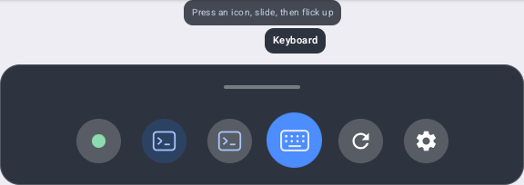
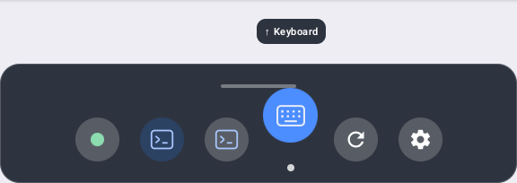

# Floating dock

The dock works like an iPhone mini's home bar. At rest it is a short (7 cm), faint pill near the
bottom of the view. A hand reaching it makes it bulge, and swiping up from it raises the dock.
Options are pressed, slid along and flicked up. The bar stays visible at the top centre of the
raised dock, and swiping down from it lowers the dock again.

## Placement

The bar sits 45 cm from the eyes, within arm's reach so it can be touched, and 38 degrees below
where the head points. The 38 degrees is clamped to 15 to 80 degrees below the horizon. Like the
home bar at the bottom of a phone screen, it stays low in the view rather than at a fixed height in
the room. It faces the eyes.

It never locks to the head. `DockFollow` leaves it in place while the head turns less than 14
degrees, nods less than 10 degrees, or moves less than 10 cm. Past that, yaw, pitch and eye
position each ease toward the new target with a 0.45 s time constant. A small glance stays still
and a large look around catches up smoothly, so the motion is never "trippy". The bar appears in
place without animating, and snaps back after a recenter or teleport. It cannot be grabbed;
terminal windows keep their own Fixed/Follow modes.

The bar is always rendered while VRcode is resumed and the head is tracked. That includes while
Settings or the cmux context menu is open, so the user can always see that VRcode loaded and has a
way back to Settings and Arrange.

## Gestures

`DockGesture` handles everything in dock-local coordinates: X right, Y up, and the dock's plane at
Z = 0.

| Step | What the user does | What happens |
|---|---|---|
| Hover | a fingertip comes within 6 cm of the bar, or a pointer aims at it | the bar brightens, widens and thickens, and shows a "⌃" cue |
| Raise | press the bar and swipe up 3 cm | the dock rises; the bar's pill follows the finger up as it swipes |
| Choose | press an option, then slide sideways | the option under the finger highlights; a knob tracks the finger |
| Activate | flick up 4 cm from the highlighted option | the option lifts with an "↑ label" cue, runs, and the dock lowers |
| Cancel | pull the finger back 7 cm from the plane | the press ends; the dock stays up |
| Lower | press the grabber (the bar at the raised dock's top centre) and swipe down 3 cm, or leave the dock alone for 5 s | the dock lowers back to the bar |

For the first three raises, a hint reads "Press an icon, slide, then flick up". The picked
option's label shows in a pill above the body, clear of the grabber, and gains an "↑" while it is
pressed.





A touch counts only when the fingertip reaches the plane from in front, inside the part being
pressed. That means the fingertip was more than 0.5 cm in front on the previous frame and is now
within 1.2 cm in front of the plane to 4 cm through it. Three cases never press anything:
- hands typing on a physical keyboard below the bar;
- a finger coming from behind the dock;
- a finger beyond the bar's ends.

After the swipe that raises the dock, the finger must leave and come back before it can press an
option, so the raise itself never selects anything. A press is dropped if hand tracking is lost
for 400 ms or the press lasts 10 s.

Pointer rays work the same way. Pinch on the bar and aim upward to raise the dock; pinch on an
option and aim up to activate it. Rays count only from at least 25 cm away. Typing hands just
below the dock have rays that graze it, and those near rays are ignored.

## Options

The options are round icons in one row, 6 cm apart. The row shrinks the spacing to stay within
42 cm when there are many windows. In order:

- **Connection** (a dot): opens Connection settings. Green means the terminal bridge is online;
  amber means it is unavailable. Keyboard, Arrange and Settings stay usable offline.
- **One icon per live cmux window**, with the focused window highlighted. Titles and removals come
  from xmux. Flicking up on a window glides it (280 ms) to sit just above the dock, its bottom edge
  24 degrees above the bar, at the window's own distance and facing the eyes. This is how to recover
  a window that has gone out of view. The window is also focused in VRcode and in cmux. Its
  Fixed/Follow mode is preserved, and the dock never creates a second terminal or caches terminal
  state. Minimized windows remain in this strip; recalling one unhides it. Recalling any window
  leaves fullscreen, restoring the fullscreen window's previous placement and mode. Closing a
  screen through its header removes it from cmux and from this strip.
- **Keyboard**: toggles the same floating keyboard as the right-hand pie. Its selected state
  follows changes made from the pie and the keyboard's close button. The keyboard opens just above
  the dock.
- **Arrange**: runs the existing terminal arrangement action.
- **Settings**: opens the existing panel and brings it back in front of the user, which also
  recovers a settings panel left out of view.

## Panels and hit testing

The dock uses two pooled panels, independent of terminal reconnects:

- **The bar.** A 10 × 5 cm panel, larger than the drawn pill so it is easier to hit. It is
  hittable, so a pointer never clicks a terminal through it.
- **The raised body.** A 48 × 17 cm panel shown only while raised. It is never hittable
  (`MeshCollision.NoCollision`), so it can never swallow terminal input. `DockFeature.hitDistance`
  treats it as foreground geometrically instead.

There is no invisible full-size quad in front of terminals. Terminal cursors, right-click and
context-menu gestures, and left-pinch voice paste treat the visible dock as a foreground panel. They
do not act through it on a terminal behind it.

Other overlays stack against `DockFeature.currentPose()` (the bar's eased pose), falling back to
`DockPlacement.pose(head)`, with `DockPlacement.WIDTH_M` and `HEIGHT_M`:

- Voice panes float above the mic in the fist instead (`voice/MicPanePlacement.kt`); only a pane
  with no mic position yet falls back to 1.5 cm above that footprint.
- The floating keyboard sits 2 cm above it.

**Never remove `IsdkGrabbable` from a panel.** The dock originally called
`removeComponent<IsdkGrabbable>()`. The SDK's panel handle system still read the component on its
next tick and aborted the app on every launch (`Failed to get component IsdkGrabbable ... wrong data
type found`, 2026-11-01). Both dock panels set `IsdkGrabbable(enabled = false)` instead.

## Code

| File | Owns |
|---|---|
| `app/.../dock/DockPlacement.kt` | the placement, sizes, footprints, ray and distance math |
| `app/.../dock/DockFollow.kt` | the lazy yaw, pitch and position follow |
| `app/.../dock/DockGesture.kt` | `DockLayout` (option spacing) and the hover, swipe, press, slide and flick state machine |
| `app/.../dock/DockRecall.kt` | the window recall target and glide |
| `app/.../dock/DockFeature.kt` | mounts the panels, reads xmux state and fingertips (from `HandAim` joints), dispatches the options |
| `settings-ui/.../DockPanel.kt` | the platform-independent `DockBar` and `DockBody` Compose UI |

`MainActivity` passes pointer rays with each hand's trigger and pinch state, ticks the dock before
the other features, and applies the recall glide each frame.

## Existing projects checked

Searched on 2026-11-01 for "cmux dock", "cmux-dock", and floating/VR toolbar variants before
implementing this panel:

- [cmux Dock](https://github.com/manaflow-ai/cmux/blob/main/docs/dock.md) is a right sidebar for
  terminal/browser surfaces and split layouts. Its `.cmux/dock.json` seeds Mac-side controls;
  it does not provide a headset-following launcher.
- [SideRail's cmux host](https://github.com/KaxyotiK/siderail/blob/main/docs/CMUX.md) supplies a Git
  TUI inside that sidebar. It likewise has no spatial placement or Quest input integration.

Neither fits the requested spatial toolbar. The implementation uses the existing xmux spatial
panel API and vrcode actions, without adding a dock dependency or patching xmux.

## Verification

```sh
./gradlew :app:assembleDebug :app:testDebugUnitTest :settings-ui:testDebugUnitTest
ANDROID_SERIAL=emulator-5554 ./gradlew :settings-ui:connectedDebugAndroidTest \
  -Pandroid.testInstrumentationRunnerArguments.class=dev.improve.vrcode.DockPanelTest
```

| Test | Checks |
|---|---|
| `DockGestureTest` | option spacing; the hover bulge; swipe-up raising without pressing an option; press, slide and flick activating and lowering; pulling back cancelling; the grabber swipe-down; the idle timeout; hands below or behind never pressing; pinched pointers raising and activating; near rays being ignored; the recall target and glide |
| `DockPlacementTest` | the gaze-relative pose and its clamping, footprints, and bar and body ray hits |
| `DockFollowTest` | the dead zones, easing, settling, following a large look down, wrap-around turns, snapping and stalled frames |
| `DockPanelTest` | the bar at rest and bulging, and the raised body with its hint and flick cue, at the headset's pixel scale; it saves captures to the test app's external `screenshots` directory |

Verified on 2026-11-01:
- `:app` compiled, and the app unit tests (119) and settings-ui tests passed.
- Both `DockPanelTest` cases passed on `emulator-5554`. Its captures (above) showed the label
  covering the grabber, so the label was moved into a pill above the body; the captures above are
  from after that fix.

Still needs a worn-headset check:
- reaching the bar comfortably;
- the swipe and flick thresholds;
- that typing hands never raise the dock.

Capture the headset with `adb shell am startservice -n com.oculus.metacam/.capture.CaptureService -a
TAKE_SCREENSHOT` while it is worn. Captures land in `/sdcard/Oculus/Screenshots`. `VrcodeDock` log
lines report "dock raised", "dock option …" and "dock lowered".
