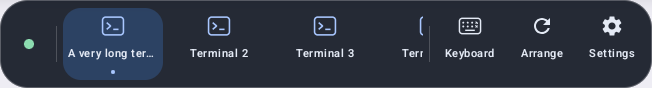

# Floating dock

The bottom dock is a Quest-native Compose panel low in the periphery at arm's reach: 40 cm below
eye height and 45 cm ahead in the facing direction (about 42 degrees below the horizon), level and
facing the eyes. A glance down brings it into view, and it can be touched directly. Only head
position and yaw matter; pitch and roll are ignored, so looking down never drags it. It does not
lock to the head: `DockFollow` leaves it in place while the head turns less than 14 degrees or
moves less than 10 cm, then eases it toward the new target (0.45 s time constant) until it settles.
It appears in place without animating, and snaps after a recenter or teleport. It cannot be
grabbed; terminal windows keep their own Fixed/Follow modes.

It is **collapsed by default** to a thin, faint line. The line is always rendered while VRcode is
resumed and the head is tracked, including while settings or the cmux context menu is open, so the
user can always see that VRcode loaded and has a way back to Settings and Arrange. Its 16 × 3 cm
panel is otherwise transparent and is the touch target. The full 66 × 9.5 cm dock opens when a hand
reaches within about 6 cm of the line, when the line is pressed, or when a pointer ray hits it from
at least 25 cm away. Hands typing on a physical keyboard sit just below the dock and their rays
graze it; near rays like those do not open it. It stays open while a pointer is on it or a hand is
within 10 cm, and collapses 1.2 s after both leave. While the floating keyboard is open, only
pointers count. The line and the full dock are separate panels, so the collapsed dock never sits as
an invisible full-size quad in front of terminals and swallows their pointer input.

**Never remove `IsdkGrabbable` from a panel.** The dock originally called
`removeComponent<IsdkGrabbable>()`; the SDK's panel handle system still read the component on its
next tick and aborted the app on every launch (`Failed to get component IsdkGrabbable ... wrong data
type found`, 2026-11-01). Both dock panels set `IsdkGrabbable(enabled = false)` instead.

- The connection dot opens Connection settings. Green means the terminal bridge is online;
  amber means it is unavailable. Recovery and keyboard controls remain usable offline.
- The middle strip shows the live cmux screens with the focused screen highlighted. It scrolls
  horizontally when there are too many windows to fit. Titles and removals come from xmux.
- Selecting a screen brings that existing window in front of the user and focuses its selected
  pane locally and in cmux. The window's Fixed/Follow mode is preserved. The dock never creates
  a second terminal or caches terminal state.
- Keyboard toggles the same floating keyboard used by the right-hand pie. Its selected state
  also follows changes made from the pie and the keyboard's close button.
- Arrange uses the existing terminal arrangement action. Settings opens the existing panel and
  brings it back in front of the user, which also recovers a settings panel left out of view.
- Terminal cursors, right-click/context-menu gestures and left-pinch voice paste respect the dock
  as a foreground panel rather than acting through it on a terminal behind it.

The dock follows the tracked **head pose**; it does not depend on eye tracking. `DockPlacement` owns
the placement, ray and hand-distance math; `DockReveal` owns the collapse timing; `DockFeature`
mounts the two panels per scene and reads live xmux state; `DockPanel` and `DockPill` contain the
platform-independent UI. Other overlays may stack against `DockPlacement.pose(head)` with
`WIDTH_M` and `HEIGHT_M` (the expanded footprint) whether or not the dock is open.

## Existing projects checked

Searched on 2026-11-01 for “cmux dock”, “cmux-dock”, and floating/VR toolbar variants before
implementing this panel:

- [cmux Dock](https://github.com/manaflow-ai/cmux/blob/main/docs/dock.md) is a right sidebar for
  terminal/browser surfaces and split layouts. Its `.cmux/dock.json` seeds Mac-side controls;
  it does not provide a headset-following launcher.
- [SideRail's cmux host](https://github.com/KaxyotiK/siderail/blob/main/docs/CMUX.md) supplies a Git
  TUI inside that sidebar. It likewise has no spatial placement or Quest input integration.

Neither fits the requested spatial toolbar. The implementation uses the existing xmux spatial
panel API and vrcode actions, without adding a dock dependency or patching xmux.



## Verification

Use the Java/Android paths in `MEMORY.md`:

```sh
./gradlew :app:assembleDebug :app:testDebugUnitTest :settings-ui:testDebugUnitTest
ANDROID_SERIAL=emulator-5554 ./gradlew :settings-ui:connectedDebugAndroidTest \
  -Pandroid.testInstrumentationRunnerArguments.class=dev.improve.vrcode.DockPanelTest
```

`DockPlacementTest` checks the target pose, ignoring pitch and roll, straight up/down, ray
hits/misses for both footprints, and hand distance. `DockFollowTest` checks the dead zone, easing,
settling, position following, wrap-around turns, snapping and stalled frames. `DockRevealTest`
checks the open/hold/collapse timing. `DockPanelTest` checks window selection, live title and
screen removal, horizontal overflow, shared keyboard state, offline action gating and recovery.
It also checks the collapsed handle's connection label and press. It saves connected/offline
panel and handle captures to the test app's external `screenshots` directory.
Actual hand/controller targeting and comfort while moving still require a worn-headset check.

Verified on 2026-11-01: the initial dock debug APK built, the app/settings unit tests passed, and both dock
Compose instrumentation tests passed on `emulator-5554`. The APK was installed on Quest 3 and the
immersive activity runs. Argent's screenshot helper fails there with “response channel closed”
(the Android screen-sharing helper aborts), and its accessibility tree exposes only system
chrome. These checks do not establish visual placement or hand targeting on the headset.

A later full rebuild encountered concurrent work outside the dock: `VoiceProp.NewsMicrophone`
references the not-yet-present `voice_prop_news_microphone` drawable. That resource must exist
before the current shared checkout can be rebuilt. The dock-specific placement and UI tests passed
before this unrelated resource change.

Lazy-follow dock verified on 2026-11-01 on Quest 3 (no crashes since install). Captures were taken
with `adb shell am startservice -n com.oculus.metacam/.capture.CaptureService -a TAKE_SCREENSHOT`
and saved under `/sdcard/Oculus/Screenshots`. They showed the collapsed line low in the view
while the wearer typed on a laptop. Before the 25 cm pointer rule, the typing hands' rays opened
the dock (`VrcodeDock: dock opened (pointer=true …)`); after it, the dock stayed collapsed.
Reaching to open it and direct touch still need a worn-headset check.
