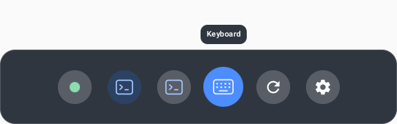

# Floating dock

The dock works like an iPhone mini's home bar. At rest it is a short (7 cm), faint pill near the
bottom of the view. A hand reaching it makes it bulge, and touching it raises the dock at once.
Touching an option runs it. The bar stays where it is, underneath the raised
options, and touching it again lowers the dock.

## Placement

The bar sits 45 cm from the eyes, within arm's reach so it can be touched, and 38 degrees below
where the head points. The 38 degrees is clamped to 15 to 80 degrees below the horizon. Like the
home bar at the bottom of a phone screen, it stays low in the view rather than at a fixed height in
the room. It faces the eyes.

It never locks to the head. `DockFollow` leaves it in place while the head turns less than 14
degrees, nods less than 10 degrees, or moves less than 10 cm. Past that, yaw, pitch and eye
position each ease toward the new target with a 0.45 s time constant. A small glance stays still
and a large look around catches up smoothly, so the motion is never "trippy". The bar appears in
place without animating, and snaps back after a recenter or teleport. It cannot be grabbed;
terminal windows keep their own Fixed/Follow modes.

The bar is always rendered while VRcode is resumed and the head is tracked. That includes while
Settings or the cmux context menu is open, so the user can always see that VRcode loaded and has a
way back to Settings and Arrange.

## Gestures

Touches come from the Spatial SDK's Interaction SDK, the same direct touch that types on the
floating keyboard: a fingertip touching a dock panel, or a pinching ray on it, reaches the panel's
Compose content as an Android touch. `DockPanel.kt` reports each touch the moment it lands
(`DockTouch`: down, move, up), without waiting for a release or a click. `DockGesture` handles them
in dock-local coordinates: X right, Y up, and the dock's plane at Z = 0.

| Step | What the user does | What happens |
|---|---|---|
| Hover | a fingertip comes within 6 cm of the bar, or a pointer aims at it | the bar brightens, widens and thickens, and shows a "⌃" cue |
| Raise | touch the bar (or pinch on it with a ray) | the dock rises on contact, in the same frame; no swipe, release or click is needed |
| Choose | bring a fingertip within 6 cm in front of an option, or aim a pointer at it | the option grows, turns blue and shows its label above the dock |
| Activate | touch the option (or pinch on it with a ray) | it runs on contact and the dock lowers; no slide, flick or release is needed |
| Lower | touch the bar again (it stays in place under the options; its cue turns to "⌄"), or leave the dock alone for 5 s | the dock lowers |




The SDK decides contact, so a fingertip has to reach a panel from in front, inside it; hands
typing below the bar or a finger behind it do not touch it. The bar's panel is 12 × 6 cm, larger
than the 7 cm pill. Only a touch's start counts. The touch that raises the dock never runs anything:
it lands on the bar's panel, and the body appears above it, so running an option needs a new
touch. For 400 ms after the bar raises or lowers the dock, further touches are ignored: direct
touch can report a finger resting on the bar as a quick release and press, which must neither flip
the dock straight back nor run an option. A touch that lands between two options runs the
highlighted one.

Pinching with a ray works the same way, because the SDK delivers it as the same touch: pinch on the
bar to raise or lower the dock; pinch on an option to run it.

The bulge and the option highlight are visual only. It comes from the index fingertips (`HandAim` joints, converted from
OpenXR VIEW space with `viewToScene`) and from pointer rays at least 25 cm away, so the near rays of
typing hands just below the dock do not light it up.

Before 2026-11-01 the app detected touches itself from the fingertip joints, without reflecting
VIEW space's Z axis. Every fingertip was placed about 40 cm behind the head, so touching the bar
did nothing and only a pinched ray could raise the dock.

## Options

The options are round icons in one row, 6 cm apart. The row shrinks the spacing to stay within
42 cm when there are many windows. In order:

- **Connection** (a dot): opens Connection settings. Green means the terminal bridge is online;
  amber means it is unavailable. Keyboard, Arrange and Settings stay usable offline.
- **One icon per live cmux window**, with the focused window highlighted. Titles and removals come
  from xmux. Touching a window glides it (280 ms) to sit just above the dock, its bottom edge
  24 degrees above the bar, at the window's own distance and facing the eyes. This is how to recover
  a window that has gone out of view. The window is also focused in VRcode and in cmux. Its
  Fixed/Follow mode is preserved, and the dock never creates a second terminal or caches terminal
  state. Minimized windows remain in this strip; recalling one unhides it. Recalling any window
  leaves fullscreen, restoring the fullscreen window's previous placement and mode. Closing a
  screen through its header removes it from cmux and from this strip.
- **Keyboard**: toggles the same keyboard as the right-hand pie and quick inputs. That is Meta's
  system keyboard when possible: `KeyboardFeature` focuses the focused terminal window's view
  (xmux's `ScreenView`, which takes typed text, backspace and keys through its Android input
  connection) and asks Android to show the soft input, so Meta's keyboard types straight into the
  focused pane. With no terminal window, while a voice pane is being edited, or if Android declines
  (logged as `system keyboard for screen N: focused=… accepted=false`), VRcode's floating keyboard
  opens just above the dock instead. The option's selected state follows the pie, the floating
  keyboard's close button, and Meta's keyboard closing itself once the window has reported it
  showing (`system keyboard closed`). Whether Meta's keyboard appears for a Spatial SDK panel needs
  a headset check.
- **Arrange**: runs the existing terminal arrangement action.
- **Settings**: opens the existing panel and brings it back in front of the user, which also
  recovers a settings panel left out of view.

## Panels and hit testing

The dock uses two pooled panels, independent of terminal reconnects:

- **The bar.** A 12 × 6 cm panel, larger than the drawn pill so it is easier to touch. It is
  always shown and hittable, raised or not, so a pointer never clicks a terminal through it.
- **The raised body.** A 48 × 15 cm panel above the bar, shown only while raised. It starts 1 cm
  above the bar's panel, so the two never overlap: the options row is centred 8.5 cm above the bar,
  and the space above the body holds the picked option's label.

Panels showing are hittable (`MeshCollision.LineTest`); the hidden body is set to
`MeshCollision.NoCollision`, so it never takes a touch or swallows terminal input.
`DockFeature.hitDistance` also treats the visible dock (bar, and body while raised) as foreground
geometrically.

There is no invisible full-size quad in front of terminals. Terminal cursors, right-click and
context-menu gestures, and left-pinch voice paste treat the visible dock as a foreground panel. They
do not act through it on a terminal behind it.

Other overlays stack against `DockFeature.currentPose()` (the bar's eased pose), falling back to
`DockPlacement.pose(head)`, with `DockPlacement.WIDTH_M` and `HEIGHT_M`:

- Voice panes float above the mic in the fist instead (`voice/MicPanePlacement.kt`); only a pane
  with no mic position yet falls back to 1.5 cm above that footprint.
- The floating keyboard sits 2 cm above it.

**Never remove `IsdkGrabbable` from a panel.** The dock originally called
`removeComponent<IsdkGrabbable>()`. The SDK's panel handle system still read the component on its
next tick and aborted the app on every launch (`Failed to get component IsdkGrabbable ... wrong data
type found`, 2026-11-01). Both dock panels set `IsdkGrabbable(enabled = false)` instead.

## Code

| File | Owns |
|---|---|
| `app/.../dock/DockPlacement.kt` | the placement, sizes, footprints, ray and distance math |
| `app/.../dock/DockFollow.kt` | the lazy yaw, pitch and position follow |
| `app/.../dock/DockGesture.kt` | `DockLayout` (option spacing), the hover and option highlight, and the bar toggle and option touches, fed by the panels' touches |
| `app/.../dock/DockRecall.kt` | the window recall target and glide |
| `app/.../dock/DockFeature.kt` | mounts the panels, queues their touches for the scene tick, switches which panel is hittable, reads xmux state and fingertips (from `HandAim` joints), dispatches the options |
| `settings-ui/.../DockPanel.kt` | the platform-independent `DockBar` and `DockBody` Compose UI, and `DockTouch` reporting |

`MainActivity` passes each hand's pointer ray (for the bulge), ticks the dock before the other
features, and applies the recall glide each frame.

## Existing projects checked

Searched on 2026-11-01 for "cmux dock", "cmux-dock", and floating/VR toolbar variants before
implementing this panel:

- [cmux Dock](https://github.com/manaflow-ai/cmux/blob/main/docs/dock.md) is a right sidebar for
  terminal/browser surfaces and split layouts. Its `.cmux/dock.json` seeds Mac-side controls;
  it does not provide a headset-following launcher.
- [SideRail's cmux host](https://github.com/KaxyotiK/siderail/blob/main/docs/CMUX.md) supplies a Git
  TUI inside that sidebar. It likewise has no spatial placement or Quest input integration.

Neither fits the requested spatial toolbar. The implementation uses the existing xmux spatial
panel API and vrcode actions, without adding a dock dependency or patching xmux.

## Verification

```sh
./gradlew :app:assembleDebug :app:testDebugUnitTest :settings-ui:testDebugUnitTest
ANDROID_SERIAL=emulator-5554 ./gradlew :settings-ui:connectedDebugAndroidTest \
  -Pandroid.testInstrumentationRunnerArguments.class=dev.improve.vrcode.DockPanelTest
```

| Test | Checks |
|---|---|
| `DockGestureTest` | option spacing; the hover bulge, including a fingertip given in VIEW space; a touch or pinch on the bar raising the dock in the first frame; touches on the hidden body doing nothing; a touch or pinch on an option running it at once and lowering the dock; a nearby fingertip highlighting an option, sticking until clearly nearer another; touches beside the row; touching the bar again lowering the dock; a finger resting on the bar neither flipping it back nor running an option; the idle timeout; near rays not bulging the bar; the body sitting above the bar without overlapping it; panel touches mapped to dock-local metres; the recall target and glide |
| `DockPlacementTest` | the gaze-relative pose and its clamping, footprints, and bar and body ray hits |
| `DockFollowTest` | the dead zones, easing, settling, following a large look down, wrap-around turns, snapping and stalled frames |
| `DockPanelTest` | the bar at rest, bulging with its "⌃" cue, and raised with its "⌄" cue; the raised body without and with a hovered option's label, at the headset's pixel scale; that both panels report a touch on contact, before any release, at the right position. It saves captures to the test app's external `screenshots` directory |

Verified on 2026-11-01:
- `:app` compiled, and the app unit tests (119) and settings-ui tests passed.
- Both `DockPanelTest` cases passed on `emulator-5554`. Its captures (above) showed the label
  covering the grabber, so the label was moved into a pill above the body; the captures above are
  from after that fix.

Still needs a worn-headset check:
- that touching the bar raises the dock at once;
- that touching an option runs it, and that hovering shows the right label first;
- that typing hands never raise the dock.

Capture the headset with `adb shell am startservice -n com.oculus.metacam/.capture.CaptureService -a
TAKE_SCREENSHOT` while it is worn. Captures land in `/sdcard/Oculus/Screenshots`. `VrcodeDock` log
lines report "dock touch down on bar|body at x,y cm", "dock raised", "dock option …" and "dock
lowered".
