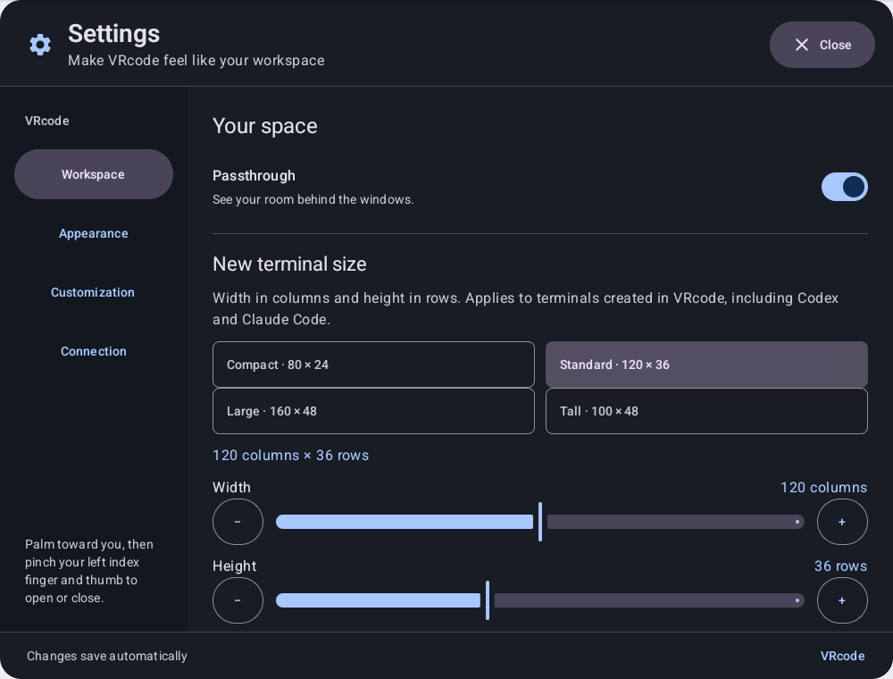
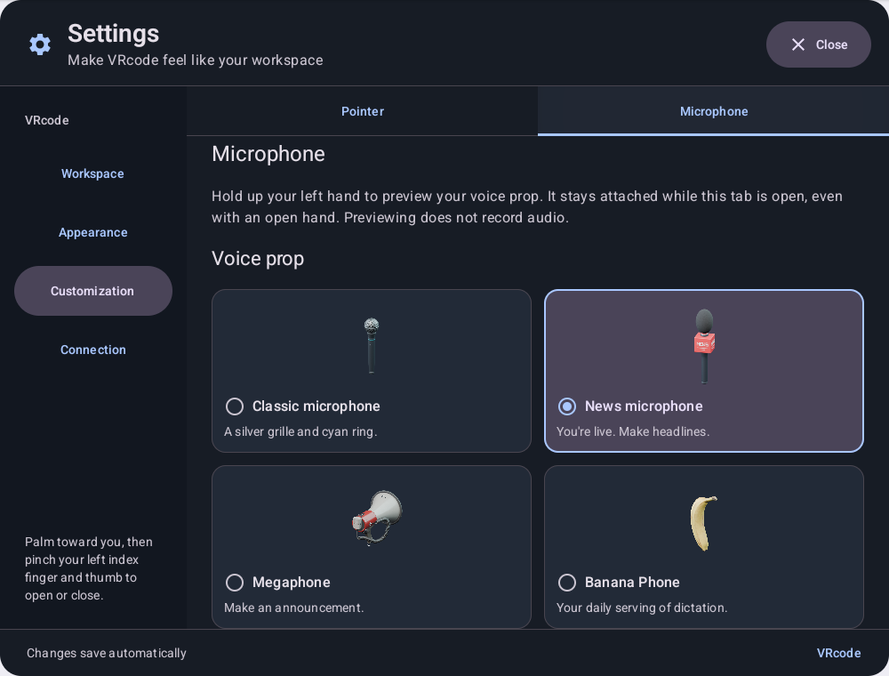

# Quest settings

The Quest app is `dev.improve.vrcode`, built with `./gradlew :app:assembleDebug`. It consumes the
external xmux checkout with the compatibility patches documented in
[terminal appearance](terminal-appearance.md); override its location using `-PxmuxDir=/path/to/xmux`.
Use JDK 17 and set `ANDROID_HOME` to the installed Android SDK. CMake 3.22.1 and NDK 27.2.12479018
build the small OpenXR hand readers.

Open Settings with the dock's gear, or toggle it with the left controller's menu button. The
Spatial SDK left menu button and the Android Menu/Start key share an edge/debounce gate so one
press cannot toggle twice. With hand tracking, the left palm + index pinch (the runtime's app menu
gesture) no longer toggles Settings: it opens the
[quick inputs ring](hand-input.md#quick-inputs-left-index-pinch), and the menu-button press or menu
key the runtime also reports for it is ignored while the left hand is a tracked hand.

Settings opens in front of the user, slightly below eye level, and stays world-locked until moved
or dismissed. The next opening places it in front of the user again, and so does returning to the
app, a recenter, or putting the headset back on while it is open, so a panel placed from a stale or
off-head pose never stays out of view. Close, Escape/Back, or the controller's menu button dismisses it.
A gear in the dock opens app Settings. Each terminal header's gear opens **Window settings** as a
top sheet inside that terminal, above its live terminal screen. The sheet is capped at 680 dp on
tall screens and fills the available terminal viewport on shorter screens. Its options scroll
while its title and Close button stay visible. Close, Escape/Back, the same gear, or the dimmed
terminal below a shorter sheet dismisses it. The collapsed dock handle
(see `docs/dock.md`) stays visible below it. The panel entity and registration are reused on subsequent openings.

With the right hand, point at a terminal's title bar, then hold a pinch or controller trigger and
drag to reposition the window. Release to leave it in place. Both macOS and Windows header styles
support dragging; the settings button, active window controls, and terminal body keep their own
input behavior. The **left hand's pinch only moves windows**, from anywhere on them or just past
an edge, and never clicks or resizes (see [hand input](hand-input.md#left-pinch-moves-windows)).
Dragging sweeps the window around the user: the grabbed point stays under the pointer at its
distance from the head, and the window turns upright to face the user (no roll), like windows
placed by Arrange. Dragged sideways, up or down, it never ends up edge-on or drifts nearer or
further away; an angled window turns to face the user when the drag starts. Movement uses the
panel's current physical scale, including windows scaled with the corner handles.

A window resizes two ways, both with the right hand (or controller) only:

- **Corners scale it.** The SDK's corner handles enlarge or shrink the whole window, text
  included, at a fixed aspect ratio (Interaction SDK `Simple` resize). The terminal keeps its
  rows and columns. The scale is saved in the window's cmux layout entry (`scale`), so it returns
  after a restart.
- **Edges change its rows or columns.** Point just past the left, right or bottom edge, at
  least 7 cm from a corner: a bar lights up beside that edge, outside the window, and turns blue
  while you drag. The band reaches about 3.4° past the edge (5 cm at arm's length, 15 cm on a
  window 2.5 m away, at most 25 cm). The focus dot and short laser remain visible over the band,
  including during the drag. Pinch or pull the trigger and drag. Tracked hands
  use the runtime's index pinch directly: the SDK's panel trigger is unavailable outside a panel.
  A pinch that closes
  within 0.3 s of the ray drifting off the band still grabs it, as long as the ray is within twice
  the band and not on the window, and a pinch that drops for less than 0.15 s keeps the drag. The
  window grows or shrinks with the pointer a whole cell at a time, and the opposite edge stays put. Until release the terminal keeps its grid, so new
  space shows empty and a cut-off part is hidden. On release vrcode pins the grid that fills the
  window in cmux through the Mac service (`TerminalGridSizing`), and the window takes that grid's
  exact size with the opposite edge (and, across the drag, the title bar) still in place. If no
  new grid arrives within 3 s, the window returns to its grid's size. The SDK's edge grab handles
  are off (`SpatialConfig.edgeGrabHandles = false`), so the edges only resize; move a window by its
  title bar. The top edge never resizes: it is the title bar's side and only moves the window, so
  pointing above a window lights no bar. A fullscreen window does not resize from its edges. Logcat shows `VrcodeWindow` lines
  `edge resize: screen N right edge by the right hand at 1.02 m x 0.71 m, 2.48 m away` (with how
  long before the pinch the ray left the edge, when it had) and `… released at 1.24 m x 0.71 m`,
  and `XmuxSpatial` / `VrcodeGridSize` lines for the requested grids.

To move a window nearer or further, push or pull the hand (or controller) holding the drag: reach
out along the pointer to send it away, draw the hand back toward you to bring it closer. Depth
engages after 3 cm of reach, so ordinary sideways drags keep their distance, and only motion along
the pointer counts (relative to the head, so walking or sweeping the arm does not). Distance scales
about 1.4× per 10 cm of reach and comes back when the hand returns. The grabbed point stays on the
pointer, the window keeps its size in the room and still faces you, and its distance stays between
0.45 m (never closer than the hand) and 4 m. The move is saved like any other drag. The header's
drag events carry only panel coordinates, so depth is read each frame from the hand whose pinch or
trigger started the drag (`TitleBarDepthDrag`); a mouse drag keeps its distance. Logcat shows
`VrcodeWindow` lines `depth drag: screen N held by the right hand at 1.40 m` and `… released at
2.10 m`.

Each terminal window has working close, minimize and maximize controls in both header styles:

- Close sends `screen.close` for that window's cmux screen ID. The live topology removes the
  window and its dock entry. It follows cmux's screen lifecycle; explicit `terminal.close` in
  Actions remains the operation for terminating a retained process. Errors appear in an info box above that terminal,
  and repeated presses while a close request is pending do not send duplicate requests.
- Minimize hides the window while keeping its live session and dock entry. Hidden windows
  receive neither pointer hits nor keyboard/voice input. Recall it from the Quest dock to show
  and focus it again. Arrange leaves minimized windows hidden.
- Maximize centers a large fullscreen panel in the current view, following head position, yaw,
  pitch and roll. It fits within 74° horizontally and 58° vertically, including tall panels.
  Other terminal windows are temporarily hidden. Press the green/restore control again to
  restore the previous placement and Fixed/Follow mode. Minimize, dock recall, Arrange and the
  Fixed/Follow toggle also leave fullscreen; minimized windows stay hidden when it ends.

Fullscreen and minimized state last for the mounted window and reset on reconnect. Fullscreen
keeps the dock and recovery controls available. Mac traffic lights sit in a recessed capsule with
28 dp colored circles carrying close/minimize/fullscreen icons. Hovering anywhere over the capsule,
including its padding, expands the entire group over 160 ms: all three controls grow together into
60 × 44 dp pills with 64 × 48 dp targets. The capsule grows from 128 × 36 to 200 × 52 dp while the
title and other header actions stay in place. Mouse hover and the Quest hand/controller ray both
drive the expansion, including with No cursor selected. Moving between the controls keeps the
group expanded; it collapses when the pointer leaves or tracking is lost. Both styles expose
Close, Minimize, Maximize / Restore window labels.

Window settings offers Fixed/Follow behavior, macOS/Windows title bars, window opacity, color
theme, text size, and cursor shape for that terminal only. Unchanged options follow the app's current preferences;
**Use app defaults** clears this window's overrides and restores the default behavior. Overrides
survive closing and reopening the sheet and panel resizing, and last for the mounted window
(reconnecting or reopening the terminal starts with app defaults). Terminal selection, keyboard
input, and voice insertion pause while a window sheet is open. App settings remain available
through the dock or palm/menu gesture.

Available app options:

- Passthrough: applies immediately. While on, the app requests contextual boundaryless mode
  through `XR_META_boundary_visibility`, so the drawn play-area boundary does not interrupt MR.
  Turning passthrough off requests boundary restoration before hiding the room. Horizon OS
  decides whether suppression is allowed; requests refused during passthrough startup are retried.
- Window distance: 0.8–2.5 m, used when new terminal windows mount. Arrange windows here brings
  currently open terminals into an arc at that distance without disconnecting their sessions.
- Workspace → New terminal size: width in columns (40–200) and height in rows (12–72), with
  sliders and one-cell adjustment buttons. Standard, the default, is 120 × 36; presets also
  include Compact (80 × 24), Large (160 × 48), and Tall (100 × 48). Changes save immediately
  and apply to new terminals created by Add terminal, Codex, Claude Code, and Terminal actions.
  Explicit dimensions in Terminal actions take precedence. Existing terminals and terminals
  discovered on connection keep their size. The floating panel follows the terminal grid's
  aspect ratio and the chosen text size. Restore default settings restores 120 × 36.
  Screen/workspace creation is sized through the new terminal's attached viewer; logcat tag
  `VrcodeWindow` reports the exact terminal ID and requested size. Other attached cmux viewers
  can constrain the shared terminal grid according to cmux's viewer-size arbitration.
- New window behavior: Fixed stays at a position in the room; Follow (the default) keeps the
  window at the same offset from where the user is, so the windows stay around them as they walk,
  stand up or sit down. Follow windows track position only: turning, looking up/down or tilting the
  head does not move them, so the user can look between windows placed all around. Small moves
  (leaning in to read, swaying) stay inside a 40 cm dead zone; past it the windows glide along on
  a spring, without bobbing with each step, and catch up when the user stops. The choice saves immediately and applies only when a new screen window mounts. Existing
  windows retain their individual mode. Each terminal title bar has a Fixed / Follow toggle on
  the right, followed by Settings, in both macOS and Windows styles. Switching modes preserves
  the current pose; switching to Fixed leaves the window where it is. Title-bar dragging and
  Arrange windows here update a following window's offset from the user. Per-window modes last for
  that mounted window; reopening a screen or reconnecting uses the saved default.
- Connect on launch: reconnect to the last bridge on startup. Disabling it leaves the saved address
  available in the connection picker.
- Connection: network discovery, manual bridge address, pairing code, status and disconnect.
- Appearance: independent macOS/Windows window controls, eight bundled terminal color presets
  plus Follow Mac, 18–36 px JetBrains Mono text, and cursor shape. Changes apply to open and new
  terminals. The live preview uses the same renderer as the terminal. See
  [terminal appearance](terminal-appearance.md) for theme sources and app-color behavior.
- Appearance → Window opacity: 30–100% in 5% steps, 80% by default, so the room shows faintly
  through every window. It is a background opacity, like Ghostty's `background-opacity`: the
  title bar, terminal body and each pane's default background become translucent, while text,
  cursors, cells an app colors itself (status bars, highlighted rows), tabs, dividers and window
  outlines stay solid. Changes apply live while dragging, to open and new windows; a window's own
  Window settings slider overrides it for that window until **Use app defaults**. The setting
  saves as `window_opacity` and syncs to VRcode Mac. Windows draw no shadow under themselves, only
  around their edges, so a shadow never darkens the room seen through a window. The Appearance
  preview sits over a colored stand-in for the room so the opacity is visible in the panel.
  Rendering uses [`patches/xmux-window-opacity.patch`](../patches/xmux-window-opacity.patch).
- Customization has a fixed subtab bar with Pointer, Text mic, AI mic and Quick inputs tabs. Each tab scrolls its own
  controls, and changing tabs starts at the top. The selected tab survives navigation to another
  settings page during the session.
- Customization → Text mic / AI mic → Mic appearance: independently preview and choose Classic microphone,
  News microphone, Megaphone, or Banana Phone, in that order. The right-hand Text mic defaults to
  Classic microphone and transcribes words as spoken; the left-hand AI mic defaults to News
  microphone, and sends the AI's keystrokes for the focused pane (Enter included when the AI
  decides the command or prompt should run). The News microphone's cube shows the
  chosen AI provider's logo on whichever mic wears it.
- Customization → AI mic → AI provider: Claude (Anthropic, the default), ChatGPT (OpenAI) or
  Gemini (Google). The Mac sends left-fist requests to that provider, using the API key added in
  VRcode Mac's "AI provider keys" section (Keychain service `dev.improve.vrcode`, accounts
  `anthropic-api-key`, `openai-api-key`, `gemini-api-key`). The choice saves as `ai_provider` and
  goes out as the `provider` of each `AI_REQUEST`. Without that provider's key, the AI pane says so
  and a paste types what was said. What you say to the AI mic is heard by a model, not taken from
  the on-device transcript (which spells "Claude Code" as "claw code"): the pane previews the
  transcript while you speak, then shows what the model heard. Claude's API takes no audio, so this
  needs a Gemini or OpenAI key in VRcode Mac, in agent mode too: the chosen provider hears when it
  can, else Gemini, then OpenAI. Without either, the AI gets the on-device transcript
  ([protocol](vrcode-protocol.md)).
- Customization → AI mic → Thinking (`ai_thinking`): **Agent, shown above** (`above`, the
  default), **Agent, shown below** (`below`) or **Quick answer** (`off`). Agent runs the
  provider's coding agent on the Mac (Claude Code, Codex or Gemini CLI, signed in with its own
  login, not the API key) over the Agent Client Protocol: it finds files and runs commands itself
  and works in the target terminal, full auto (no approval prompts), while its thinking and each
  step stream onto a panel just above or below that window, with Stop. When it finishes, the panel
  shows what it did for 6 s. Follow-up requests to the same terminal continue its session. Quick
  answer makes one API call with the key below, shows no panel and only types. Goes out as
  `agent` in each `AI_REQUEST`; see [the protocol](vrcode-protocol.md).
- Customization → AI mic → Model: the chosen provider's models, fastest first. Claude: Haiku 5.5,
  Sonnet 5.5 (the default), Opus 5.5, Fable 5.1. ChatGPT: GPT-6 Luna, GPT-6.1 Terra, GPT-6.1 Sol
  (the default), GPT-6 Astra. Gemini: 3.5 Flash-Lite, 3.8 Flash (the default), 4 Argon. Each
  provider keeps its own choice (`ai_model_claude`, `ai_model_openai`, `ai_model_gemini`, saved as
  the API model id), so switching providers and back restores it. The current provider's choice
  goes out as the `model` of each `AI_REQUEST`; a saved id that is no longer offered falls back to
  the provider's default. VRcode Mac shows only the selected provider's models (`shownWhen`). The app loads `voice-props/news-microphone-<provider>.glb`.
  If a model is missing from the APK, it shows the classic microphone instead of failing to load.
  Old shared classic/default selections upgrade to these defaults; custom left-hand props survive
  on the AI mic, and saved boombox selections become News microphone. Each choice
  applies immediately to the hand-held model during dictation and the live settings preview, saves immediately,
  and restores on launch. All four GLBs and their previews ship with the app, so selection works
  offline. Listening feedback and staged-transcript behavior are shared across looks.
  While a mic subtab is visible, the selected prop follows that mic's hand's grip position
  and rotation even with an open hand. It needs no Mac connection, fist, or audio permission, and
  does not start recording. The preview ends on leaving that subtab, closing Settings, or pausing
  the app, and hides when hand tracking is lost (after the existing 250 ms tracking grace period).
- Customization → Pointer → Pointer cursor: Arrow (default), Dot, Crosshair, or No cursor, with previews and
  a 75–200% size control for visible cursors. Changes save immediately and apply to the right-hand
  pointer. No cursor hides the graphic and pressed-state halo while pinch clicks and drags
  stay enabled. This preference is separate from the terminal's text cursor in Appearance.
- Customization → Pointer → Pinch and drag: **Scroll** (default) or **Select text**, saved as
  `pinch_drag` and synced to VRcode Mac. Scroll sends wheel rows to apps that track the mouse
  (Claude Code, Codex); a plain shell prompt has nothing to scroll. Select text keeps the
  highlight-and-copy drag ([hand input](hand-input.md#pointer-cursor-scrolling-and-text-selection)).
- Customization → Quick inputs: what each direction of the
  [quick inputs ring](hand-input.md#quick-inputs-left-index-pinch) sends. A 3 × 3 keypad shows the
  eight directions around the pinch point; pick one, then pick its input below or **Leave empty**.
  Inputs: Esc, Ctrl-C, Tab, Enter, Shift-Tab, Backspace, the four arrows, Ctrl-D, Ctrl-Z, Ctrl-L,
  Ctrl-R, Page Up, Page Down, Home, End and Keyboard (shows the floating keyboard). Choosing a key
  that is already on the ring swaps it with the chosen direction's, so each key appears once. The
  default is Esc top-left, Ctrl-C top-right, Tab bottom-left and Enter bottom-right; **Restore
  default quick inputs** (or Restore default settings) brings it back. Changes save as
  `quick_inputs` (eight comma-separated entries clockwise from the top, empty where nothing is
  placed) and apply to the ring at once, including from VRcode Mac.
- Restore default settings: restores the preferences above, retaining the last bridge address and
  xmux pairing credentials.

Preferences are app-private `SharedPreferences`, saved on every change and on pause. Hardware
keyboard input and voice insertion gestures do not reach terminals while Settings is open.
The first launch opens the Connection page; once the initial connection has screens, that setup
panel closes. Subsequent settings openings show Workspace.

The menu only exposes implemented app features. Future audio routing, Mac display, hand-role and
Mac service settings from PLAN.md still need their respective implementations.

## Verification

`TerminalWindowSettingsSheetTest` checks both header styles, independent settings on two mounted
terminals, reopening and resetting overrides, full-height scrolling in a 320 dp terminal, a capped
top sheet on a tall terminal, and dismissal without recreating the terminal body. Its screenshots:
[short terminal](screenshots/window-settings-short-top.png),
[short terminal scrolled](screenshots/window-settings-short-scrolled.png), and
[tall terminal](screenshots/window-settings-tall.png).

2026-11-01 window-settings verification: all three sheet checks and five header checks passed on
the Android emulator. App/settings/xmux-spatial unit tests, xmux API checks, Bun tests, and asset
validation passed. Installed on Quest 3 over Wi-Fi (`lastUpdateTime` 13:16:05) and relaunched; the
checked process log showed the bridge online and terminal controls mounted, with no app crash.
Argent exposed only Quest system chrome, so hand targeting of the sheet still needs a wearer check.

`WindowOpacityTest` renders a terminal window the way the app builds it (clear frame, screen view
painting the body) over a red stand-in for the room. At 50% the pane, the body around it and the
title bar each read exactly one translucent layer, and an app-colored cell stays solid; at 100%
nothing of the room shows. It also checks the 80% default, saving the app setting, a window's
own override and **Use app defaults**. Captures: `window-opacity-50.png`, `window-opacity-100.png`.
2026-11-01 window-opacity verification: that test plus the sheet, header, appearance and shadow
instrumentation tests (14) passed on the Android emulator; app and settings unit tests, Bun tests
and asset validation passed. Not yet installed on the Quest (it was off the network), so how
legible 80% is against a real room still needs a wearer check.

Unit tests: `./gradlew :app:testDebugUnitTest :settings-ui:testDebugUnitTest`.
`TerminalSizeSettingsTest` checks all four presets, independent custom width/height, one-cell
adjustments, saving, reload, bounds, and restoring the standard size. The production panel at
1000 × 760 dp is shown below.

`PointerCursorSettingsTest` checks style/size selection, saving, reload, and restoring defaults;
`PointerCursorRenderingTest` checks every shape, scaling, hidden mode, and clicks passing through.
`WindowMotionTest` covers translation and all three head rotations, switching without a jump,
tracking becoming available, independent windows, rebasing after a drag/arrange, minimizing,
fullscreen fit and restoring each previous mode. `TerminalHeaderTest` exercises both styles and
independent screen callbacks, including the fullscreen restore label. The isolated real-daemon
cmux integration test closes one screen while another is focused and verifies the survivor. A wearer
still needs to check perceived stability and comfort while walking and looking around on Quest.

2026-11-01 window-control verification: debug build, app/settings/xmux-spatial unit suites,
four header instrumentation tests and five real cmux integration tests passed. Bun tests and
asset validation passed. The APK was reinstalled on Quest 3 and relaunched (`lastUpdateTime`
12:59:02); no app crash appeared in the checked process log. Argent exposed only Quest system
chrome after launch, so this does not establish in-headset hand targeting or fullscreen comfort.

Compose UI tests: `ANDROID_SERIAL=emulator-5554 ./gradlew :settings-ui:connectedDebugAndroidTest` on an Android emulator with a
viewport of at least 1000×760 dp (the actual VR panel dimensions). These exercise the production
panel, preference save/reload, navigation, arrangement callback, defaults and Close, and write
`settings-workspace.png`, `settings-connection.png`, and `settings-customization.png` under the test
app's external files. The customization test selects every prop, checks exclusive selection,
reloads the saved choice into recreated UI state, and verifies restoring defaults.
Window-mode tests also cover preference reload/default restoration and title-bar toggling in both
styles, with right-side actions staying clear of long titles and the terminal body staying mounted.
For a standard phone emulator, temporarily use `adb shell wm size 1200x1000` and
`adb shell wm density 160`, then reset both after testing.

On Quest, use Argent to launch `dev.improve.vrcode`; logcat tag `VrcodeMenu` reports successful
tracker creation. Actual palm-pinch recognition, comfortable placement and right-ray use require
a wearer. Menu-key injection only checks an equivalent input route. The Quest's immersive panels
may not appear in the Android accessibility tree; do not infer tap coordinates from screenshots.

The Text mic follows the right hand during right-fist dictation and in its settings subtab.
The AI mic follows the left hand during AI input and in its settings subtab. Initial
grip placement and mouth clearance still need wearer verification; the settings emulator test
checks the picker and persistence, and does not substitute for that headset check.

Boundary verification: logcat tag `VrcodeBoundary` reports accepted requests or the exact OpenXR
result when refused. With passthrough enabled, verify in-headset that crossing the existing
play-area edge does not interrupt the app. Disable passthrough inside the play area and verify
that the boundary is restored. Tracking loss and other OS safety interruptions remain possible.
The app declares `com.oculus.permission.BOUNDARY_VISIBILITY` and registers the extension on the
SDK-owned OpenXR instance. It does not use the unconditional `BOUNDARYLESS_APP` manifest feature,
because the app can turn passthrough off. See [Meta's contextual boundaryless guidance](https://developers.meta.com/vr/documentation/unity/unity-boundaryless/).

2026-11-01 device check: debug APK built and updated in place on Quest 3; the permission was
granted and HorizonStandalone logged the extension as available and enabled. Guardian refused
the request with `XR_ERROR_RUNTIME_FAILURE` (`-2`) while its system was `SUSPENDED` (headset off
head). Suppression/restoration still needs the wearer check above; API availability alone does
not prove that the boundary was suppressed.
